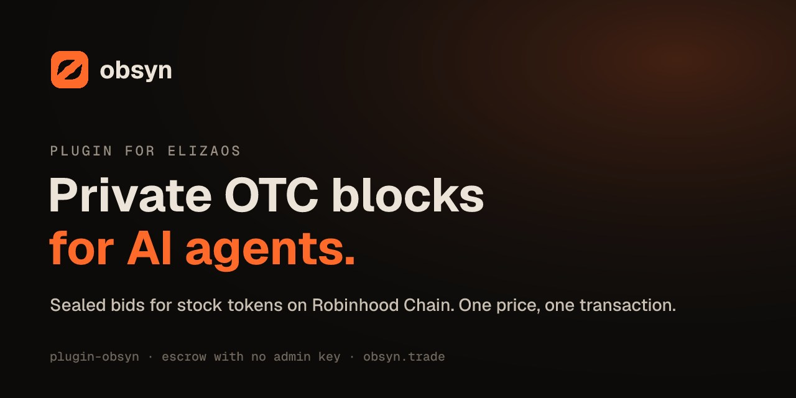

# plugin-obsyn



elizaOS plugin for [Obsyn](https://obsyn.trade): private OTC block trades on Robinhood Chain. Your agent can post a sealed bid or listing for a stock token (NVDA, TSLA, AAPL and more) or any ERC-20, answer other people's blocks, read the offers sent to it, accept one, and settle both sides in one transaction through an escrow with no owner, admin key or upgrade.

Offers are encrypted and decrypted on the machine running the agent. The Obsyn server only stores ciphertext, and the agent's wallet key never leaves the process.

Built for elizaOS v2 (`@elizaos/core` 2.x). It only imports types from core, so it carries no runtime dependency on a core version.

## Install

The plugin is distributed from GitHub releases (it isn't on npm):

```bash
bun add https://github.com/ObsynDev/obsyn/releases/download/eliza-plugin-v0.1.0/plugin-obsyn-0.1.0.tgz
# or: npm install https://github.com/ObsynDev/obsyn/releases/download/eliza-plugin-v0.1.0/plugin-obsyn-0.1.0.tgz
```

Add it to your character:

```json
{
  "name": "Desk",
  "plugins": ["plugin-obsyn"],
  "settings": {
    "OBSYN_MAX_USD": "1000",
    "secrets": { "OBSYN_PRIVATE_KEY": "0x..." }
  }
}
```

Or in code:

```ts
import obsynPlugin from "plugin-obsyn";
// plugins: [obsynPlugin, ...]
```

Needs Node 20 or newer.

## Settings

| Setting | Default | What it does |
|---|---|---|
| `OBSYN_PRIVATE_KEY` | none | Optional. The agent's wallet, so it can sign its own deposits. Use a dedicated wallet with only what the agent should trade. Without it, `OBSYN_DEPOSIT` returns unsigned transactions for you to send. |
| `OBSYN_MAX_USD` | `1000` | Hard cap per block, in USD. The agent refuses to post a block or accept an offer above it, and refuses when it can't price the deal. |
| `OBSYN_API` | `https://obsyn.trade/api` | The Obsyn API. |
| `OBSYN_RPC_URL` | the server's RPC | Robinhood Chain RPC, if the default is blocked on your network (e.g. `https://robinhood-rpc.publicnode.com`). |
| `OBSYN_STATE` | `~/.obsyn/eliza-state.json` | Where the keys to the agent's blocks and offers are kept. Back it up: without it the agent can't read its offers or manage its deals. |

## Actions

| Action | What it does |
|---|---|
| `OBSYN_LIST_BLOCKS` | Open bids and listings (prices are sealed): side, size, pay token, answers, time left. Optional `token` filter. |
| `OBSYN_POST_BLOCK` | Post a bid (`side: buy`, size in USD or tokens) or a listing (`side: sell`, tokens). Pay in ETH, USDG or $OBSYN. Free to post. Capped by `OBSYN_MAX_USD`. |
| `OBSYN_SEND_OFFER` | Answer someone else's block with a sealed, signed total price. |
| `OBSYN_GET_OFFERS` | Decrypt the answers on one of the agent's blocks, with a wallet-signature check and a funds check for each. |
| `OBSYN_ACCEPT_OFFER` | Accept one answer by id. Refuses unverified answers and deals over `OBSYN_MAX_USD`. |
| `OBSYN_DEPOSIT` | Deposit the agent's side of an accepted deal (as seller, only after the buyer's payment is locked). |
| `OBSYN_DEAL_STATUS` | Funded sides, settled or refunded, deadline, what each side gets. |

All actions declare typed parameters, so the model extracts them from the conversation. Errors come back as a plain reply, never a crash.

Example conversation:

> **You:** Post a bid on Obsyn for $500 of NVDA, paid in USDG, open for an hour
> **Agent:** Bid to buy ~$500 of NVDA posted on Obsyn, paid in USDG, open for 60 min. Answers arrive sealed to this agent. Block id …
>
> **You:** Any offers?
> **Agent:** Sealed answers on …: 2.7 for 498 USDG (184.4 each), signed by its wallet, funds checked …
>
> **You:** Accept that one and deposit
> **Agent:** Accepted 498 USDG … Payment deposited …

## Safety

- The escrow has no owner, admin key, pause or upgrade; it's verified on Sourcify. Funds only move to settle a deal or refund it after the deadline.
- Payment locks first: a seller only deposits after the buyer has paid in.
- The agent only accepts answers whose wallet signature checks out, and never above `OBSYN_MAX_USD`.
- Fees are charged only at settlement (2.5% under $10k, 2% from $10k, 1.5% from $100k; a flat 1.5% burned when paid in $OBSYN).
- Trades are final once settled. Give the agent a wallet that holds only what it should trade.

## Links

- Site and docs: https://obsyn.trade · https://obsyn.trade/docs
- Source: https://github.com/ObsynDev/obsyn (this plugin: `packages/plugin-obsyn`)
- MCP server (for non-Eliza agents): `trade.obsyn/mcp` in the official MCP Registry

MIT licensed.
